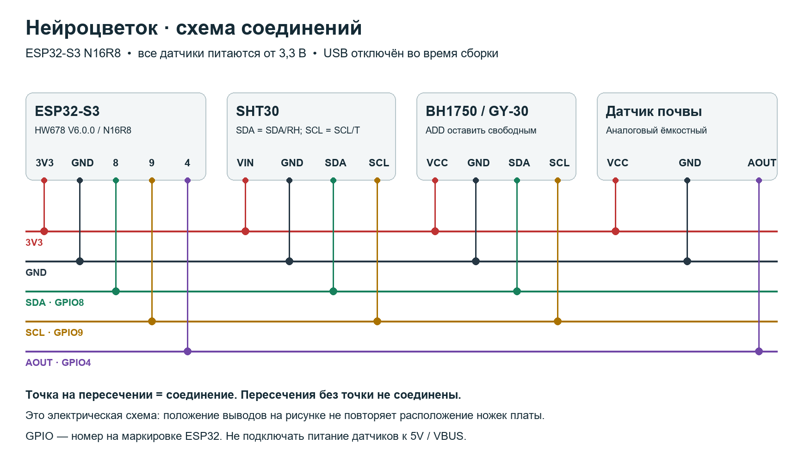
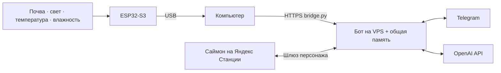

# Нейроцветок — Стёпа 🌵

Алоэ с характером: измеряет состояние своего горшка, разговаривает в Telegram, помнит поливы и просит показать, как выглядит. В нашей сборке вопросы Стёпе можно задавать и через Саймона на Яндекс Станции.

Здесь лежат исходники прошивки, бот, список деталей и схема сборки из видео. Стёпа — персонаж на основе GPT и настоящих измерений. Вода пока льётся руками: насоса в проекте нет.



## С чего начать

1. [Купить детали](docs/parts.md).
2. [Собрать по схеме и проверить питание](docs/wiring.md).
3. [Собрать и загрузить прошивку](firmware/README.md).
4. [Запустить своего Telegram-бота](bot/README.md).
5. [Откалибровать влажность на своём грунте](docs/calibration.md).
6. По желанию: [бот на VPS](docs/server.md) и [связь с Саймоном](integrations/simon/README.md).

## Что умеет

- Показывает почву, освещённость, температуру и влажность воздуха по кнопке «Показатели».
- Разговаривает от лица колючего жителя подоконника, помнит последние реплики и события.
- Запоминает подтверждённый полив, хранит историю и калибровку в SQLite.
- При устойчивой сухости просит фото и ручную проверку грунта перед решением о поливе.
- Просит обычное фото примерно раз в неделю; проверяет нехватку света за два завершённых дня с достаточным количеством измерений.
- Анализирует присланное фото через OpenAI API. По фотографии нельзя измерить влажность корней или достоверно поставить диагноз.
- Возвращает отдельный текст для голоса: числа и даты произносятся словами, без чтения экранной таблицы.

## Как это связано



Начать можно без VPS: запустить бота на компьютере, к которому подключена плата. В варианте с VPS компьютер передаёт только измерения, а разговоры и память живут на сервере.

**Для свежих показаний в этой версии компьютер должен быть включён и не спать.** ESP32 работает по USB. Автономный Wi-Fi в этот публичный комплект не входит. При потере измерений бот отмечает их устаревшими и не делает выводов о нынешней сухости или темноте.

## Что внутри

| Папка | Содержимое |
|---|---|
| `firmware/` | Прошивка PlatformIO для ESP32-S3 N16R8 |
| `bot/` | Telegram, персонаж, память, правила ухода, USB-мост и тесты |
| `docs/` | Детали, схема PNG/SVG, макетка, калибровка, VPS |
| `deploy/` | Пример systemd-сервиса и nginx |
| `integrations/simon/` | Адаптер и обработка голосового ответа для существующего Саймона |

Проверенная плата: ESP32-S3 N16R8, HW678 V6.0.0. Датчики: BH1750 / GY-30, SHT30 / SHT3x, аналоговый ёмкостный датчик почвы. Точное название сорта алоэ по фото не подтверждено; текущий профиль предполагает Aloe «Delta Lights».

Проект однопользовательский. Создайте отдельного бота, задайте свой числовой `owner_id` и собственные ключи. API оплачивается отдельно. Рабочие ключи, личные фотографии, история чата и наша калибровка в репозиторий не включены.

Персонажа можно изменить в `bot/character_prompt.txt`. По умолчанию это Стёпа и хозяин Егор. Для другого хозяина замените имя также в приветствии `bot.py`, проверке голосовых команд `voice.py` и метаданных адаптера Саймона. Это имя роли, а не распознавание личности по голосу.

## Проверка кода

Из папки `bot`, после установки зависимостей:

```sh
python -m unittest discover -s tests -v
```

Из папки `firmware`:

```sh
pio run -e esp32s3-usb
```

Состояние публичного комплекта и ограничения проверки: [RELEASE.md](docs/RELEASE.md).
