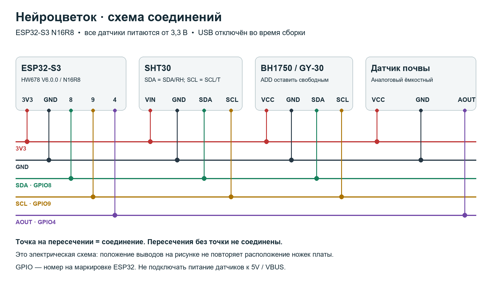
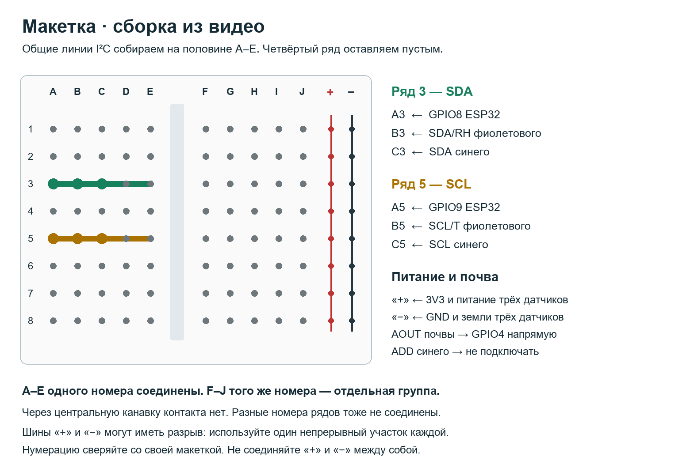

# Подключение

Перед перестановкой проводов отключите USB и другое питание. Соберите схему, проверьте 3V3/GND и отсутствие соединения плюса с минусом, затем подключайте USB. Цвет провода — только подсказка; ориентируйтесь на подписи выводов.

[Векторная версия для печати](wiring.svg) · [Макетная плата](breadboard.png)

## Таблица соединений

| Модуль | Его вывод | Куда |
|---|---|---|
| ESP32-S3 | 3V3 | Красная шина «+» макетки |
| ESP32-S3 | GND | Синяя шина «−» макетки |
| SHT30 | VIN | «+», то есть 3V3 |
| SHT30 | GND | «−», общий GND |
| SHT30 | SDA/RH | GPIO8, общая SDA |
| SHT30 | SCL/T | GPIO9, общая SCL |
| BH1750 / GY-30 | VCC | «+», то есть 3V3 |
| BH1750 / GY-30 | GND | «−», общий GND |
| BH1750 / GY-30 | SDA | GPIO8, общая SDA |
| BH1750 / GY-30 | SCL | GPIO9, общая SCL |
| BH1750 / GY-30 | ADD | Оставить свободным для этой сборки |
| Датчик почвы | VCC | «+», то есть 3V3 |
| Датчик почвы | GND | «−», общий GND |
| Датчик почвы | AOUT | GPIO4 напрямую |

**GPIO8 — вывод с маркировкой 8, а не восьмой контакт от края.** Аналогично GPIO9 и GPIO4. Расположение контактов может различаться у вариантов платы — схема показывает электрические связи, не вид платы сверху. Не заменяйте 3V3 на 5V/VBUS.

## Как мы собрали макетку

1. ESP32 **GPIO8 → A3**, SHT30 **SDA/RH → B3**, BH1750 **SDA → C3**. Это одна общая линия SDA.
2. ESP32 **GPIO9 → A5**, SHT30 **SCL/T → B5**, BH1750 **SCL → C5**. Это отдельная общая линия SCL.
3. Четвёртый ряд оставляем пустым. D3/E3 и D5/E5 можно не использовать.
4. Все три питания датчиков подключаем к тому же непрерывному участку «+», куда пришёл 3V3 от ESP32. Все земли — к участку «−» с GND ESP32.
5. AOUT почвы идёт напрямую на GPIO4. ADD синего датчика остаётся свободным.

В обычной макетке A–E одного номера соединены внутри; F–J того же номера — другая группа. Через центральную канавку связи нет. Соседние номера рядов не соединены. Шины питания нередко разорваны посередине: при использовании разных участков проверьте их непрерывность и соедините «+» с «+», «−» с «−» перемычками. Не соединяйте плюс с минусом.

BH1750 и SHT30 разделяют одну I²C-шину, потому что адреса разные. Прошивка ищет BH1750 на 0x23/0x5C, SHT30 на 0x44/0x45.

Штырьки датчика не должны просто лежать в непропаянных отверстиях: нужен надёжный контакт. Не погружайте верхнюю часть почвенного щупа с компонентами в грунт или воду. Насос и реле в этой схеме отсутствуют.
